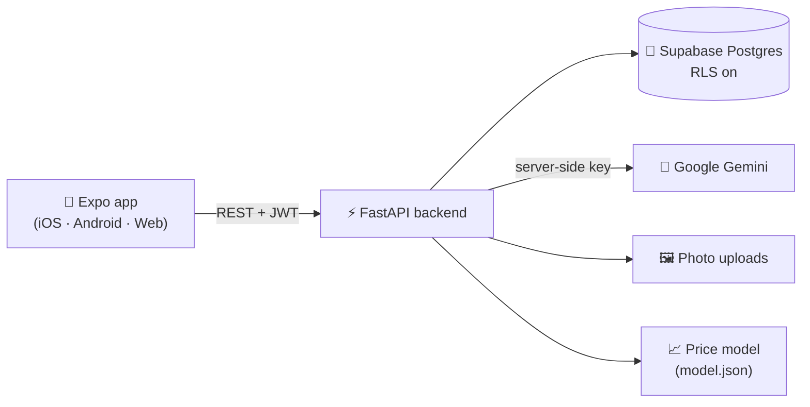

<div align="center">

# ♻️ GREEN · Second Life

### Buy, sell and swap pre-loved campus gear, at a price everyone can see is fair.

Snap a photo → AI recognises the item → a fair price is suggested **with the reasons** → buyers chat, make offers or swap.


</div>

---

## 🌱 The problem

Every semester, graduating students throw away calculators, cycles, textbooks and lab coats, and the next batch buys them new.
Campus resale already happens in WhatsApp groups, but it has three problems:

1. **Nobody knows a fair price.** Sellers guess, and buyers don't trust the number.
2. **No cash means no deal.** A student with something to trade but no money can't take part.
3. **There's no trust.** Phone numbers are shared with strangers, and it's hard to tell who is reliable.

## 💡 Our solution

**GREEN · Second Life** is a campus marketplace app that fixes all three:

| | |
|---|---|
| 💰 **Explainable fair pricing** | A model fitted on past campus sales suggests a price **and shows why**: age, condition, category and season. |
| 🔄 **Swaps, not just sales** | Trade item for item. The app values both and tells you who should add how much to make it fair. |
| 🛡️ **Built-in trust** | Private in-app chat (no phone numbers), offers recorded in the chat, seller trust badges and safety tips. |
| 🤖 **AI that does the boring part** | Take a photo and Gemini identifies the item, brand and model and fills in the listing. |

Every item resold or swapped is **one less new purchase and one less item in a landfill**. Items stay on campus, so there's no shipping.

---

## ✨ Features

### 🤖 AI (Google Gemini)
- **Snap to list:** Gemini identifies the item from the first photo (name, brand, model, category, condition, typical new price in India, highlights) and fills the empty fields.
- **GREEN Assistant:** a chatbot ("Ask AI" on Browse) that knows the items for sale right now and links to them. Ask *"Find me a calculator under ₹600"* or *"What should I charge for my 2-year-old cycle?"*
- The API key stays **on the server only**. Requests are rate-limited, and the server **falls back to backup models** if the main one is busy.

### 💰 Fair pricing
- A **suggested price, a price range and a confidence level** for every listing.
- **"Why this price?":** 3–4 plain-language reasons plus the closest past sales.
- **Price trends:** how prices move by category and season.
- **Fair-offer meter:** a buyer's offer is labelled *steal / fair / pricey* against the fair price.

### 📸 Selling
- **Sell in 60 seconds:** a fast posting flow.
- **Camera or gallery**, **up to 6 photos**. Choose the cover and remove photos you don't want; photos upload as soon as you pick them.
- **My listings:** edit, mark as sold or delete your items. Your own items are kept out of Browse.

### 🛒 Buying
- **Search**, **category chips** and **filters** (price, condition, sort).
- Item pages with a **photo gallery** you can swipe through, the seller's trust badges and the price explanation.

### 💬 Messaging and offers
- **Contact seller** opens a private chat about that item.
- **Quick replies**, **price offers** the seller can **accept or decline**, and an automatic deal message when they accept.
- An **inbox with unread badges**. Chats refresh every few seconds, and every chat shows a safety tip.

### 🔄 Swaps
- Propose an item-for-item swap. The app quotes **a fair cash top-up** (e.g. *"they add ₹370"*).
- Accept or decline incoming swaps from the Swaps tab.

### 📢 Wanted requests
- Can't find something? Post what you want. The app **matches it to existing listings** automatically.

### 🛡️ Trust and security
- **Trust badges** and stats for each seller.
- JWT access tokens plus refresh tokens. Login holds up on a poor network (you're only logged out when the server says so).
- **Row Level Security** on every Supabase table, input checks, rate limits, upload checks, and secrets only on the server.

---

## 🏗️ Architecture



The app **only** talks to our API. It never sees the database password, the Supabase keys or the Gemini key.

| Layer | Tech |
|---|---|
| Mobile app | Expo SDK 58, React Native, TypeScript, Expo Router, NativeWind (Tailwind), TanStack Query |
| Backend | FastAPI, SQLModel, Pydantic, JWT auth, response cache that refills itself after changes |
| Database | Supabase Postgres (via the session pooler); SQLite for local development |
| AI | Google Gemini `generateContent` (vision + chat, JSON response schema) |
| Pricing | Fitted per category from 200 sample campus sales (`data/`) |

```
/app       Expo app: screens in src/app, shared UI in src/components, API client in src/lib
/backend   FastAPI app: routes/, pricing.py, ai.py, models.py; tests/ has 49 pytest tests
/data      generate_data.py → listings.csv, fit_model.py → model.json
/docs      API.md (endpoint reference), PROMPT_LOG.md
```

---

## 🚀 Run it locally

**You need:** Python 3.11+, Node 22+, and the **Expo Go** app on your phone. Your phone and laptop must be on the same Wi-Fi.

```bash
# 1. Backend
cd backend
python3 -m venv .venv && .venv/bin/pip install -r requirements.txt
cp .env.example .env            # then fill in the values (see below)
.venv/bin/python -m uvicorn app.main:app --host 0.0.0.0 --port 8787
```

```bash
# 2. App (new terminal)
cd app
npm install
npx expo start --lan            # scan the QR code with Expo Go
```

The app finds the backend on its own (your laptop's LAN IP, port **8787**). Press `w` in the Expo terminal to open the web version.

**Demo login:** `demo@example.com` / `Demo@1234`, or tap **"Sign in as Demo Student"**. All seeded people are clearly fake.

**Checks:**
```bash
cd backend && .venv/bin/python -m pytest -q     # 49 tests
cd app && npx tsc --noEmit                      # type check
```

### Environment variables

| File | Variable | Purpose |
|---|---|---|
| `backend/.env` | `DATABASE_URL` | Supabase Postgres connection string (session pooler). Defaults to local SQLite. |
| `backend/.env` | `JWT_SECRET` | Signs login tokens. If blank, a random dev secret is generated. |
| `backend/.env` | `GEMINI_API_KEY` | Turns on photo recognition and the assistant. If blank, the AI parts show "switched off" and everything else works. |
| `backend/.env` | `GEMINI_MODEL` | Optional; defaults to `gemini-flash-latest`. |
| `backend/.env` | `GOOGLE_*_CLIENT_ID` | Optional Google sign-in. |
| `app/.env` | `EXPO_PUBLIC_API_URL` | Optional backend URL (deployed server or tunnel). |

> ⚠️ **Never put secrets in `app/.env`.** Anything starting with `EXPO_PUBLIC_` is bundled into the app. `backend/.env` is git-ignored. Keep it that way.

<details>
<summary><b>Using Supabase as the database</b></summary>

1. Create a project at supabase.com and remember the database password.
2. Dashboard → **Connect** → copy the **Session pooler** string (works over IPv4).
3. Put it in `backend/.env`, replacing `[YOUR-PASSWORD]`. URL-encode special characters (`@` → `%40`, `#` → `%23`, `/` → `%2F`, `:` → `%3A`):
   ```
   DATABASE_URL=postgresql://postgres.<project-ref>:<password>@aws-0-<region>.pooler.supabase.com:5432/postgres
   ```
4. Check the connection and create the tables:
   ```bash
   cd backend && .venv/bin/python -m app.check_db
   ```
   Every table should show `row level security: ON`.
5. Start the API. An empty database is seeded with demo data on the first start, and columns added later are created automatically.

</details>

<details>
<summary><b>Google sign-in</b></summary>

Create OAuth client IDs in Google Cloud Console and put them in both `.env` files. Expo Go can't complete Google's redirect on a phone, so use a development build (`npx expo run:android` / `run:ios`) or Expo web. Email and password sign-in works everywhere.

</details>

---

## 📈 How the pricing works

`data/fit_model.py` fits a depreciation curve **per category**:

```
log(sold_price / original_price) = intercept + b·age + condition effect   (+ "new edition" step for textbooks at 3+ years)
```

`POST /price/suggest` applies it, adds a small **seasonal factor** (prices peak when juniors arrive in July–August), and returns:
- the suggested price and a range (from the residual quartiles),
- a confidence level,
- plain-language reasons and the closest past sales.

Categories with fewer than 8 sales fall back to the all-category model and report **low** confidence, so the app never claims more certainty than the data supports.

**Example:** scientific calculator, 2 years old, good condition, bought at ₹1,200 → **about ₹540** (range ₹500–₹570).

---

## 🔌 API at a glance

| Area | Endpoints |
|---|---|
| Auth | `POST /auth/register` `/login` `/refresh` `/logout` `/google` |
| Listings | `GET /listings` (search, filters, `exclude_seller_id`) · `GET /listings/mine` · `POST` · `PUT` · `DELETE` · `POST /listings/{id}/sold` |
| Pricing | `POST /price/suggest` · `GET /insights` |
| Swaps | `GET /swaps/quote` · `GET/POST /swaps` · `POST /swaps/{id}/accept` `/decline` |
| Wanted | `GET/POST /wanted` · `GET /wanted/{id}/matches` · `DELETE` |
| Chats | `POST/GET /chats` · `GET /chats/unread` · `GET /chats/{id}` · `POST /chats/{id}/messages` · `POST /chats/{id}/offers/{msg}` |
| AI | `GET /ai/status` · `POST /ai/identify` · `POST /ai/chat` |
| Other | `POST /uploads` · `GET /sellers/{id}/trust` · `GET /me/stats` · `GET /health` |

Full details are in [`docs/API.md`](docs/API.md).

---

## 🗺️ What's next

- 🎓 College email verification for every account
- 🌍 A personal impact counter: CO₂ and money saved by buying second-hand
- 🔔 Push notifications for new messages and Wanted matches
- ☁️ Photos moved to Supabase Storage, and a hosted deployment
- 📊 Retrain the price model on real completed sales

---

<div align="center">

Built for the **GoDaddy Hackathon** 💚 · *Keep good stuff on campus and out of the bin.*

</div>

